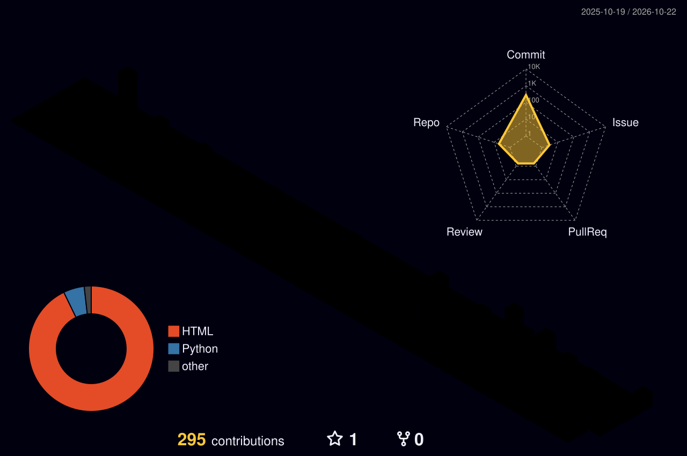

<!--
  GitHub Profile README · youze27
  紧凑排版：所有卡片共用一个居中容器，用   分行，避免段落之间的 16px 间距；卡片宽度整体缩小。
  贪吃蛇 / 3D 贡献图依赖 .github/workflows 下的 Action 生成，需要在 Actions 页手动 Run 一次。
-->

  
   
  
  
  
   
  
   
  
  
   
  
  
   
  
   
  <picture>
    <source media="(prefers-color-scheme: dark)" srcset="https://raw.githubusercontent.com/youze27/youze27/output/github-snake-dark.svg" />
    <source media="(prefers-color-scheme: light)" srcset="https://raw.githubusercontent.com/youze27/youze27/output/github-snake.svg" />
    
  </picture>
  

